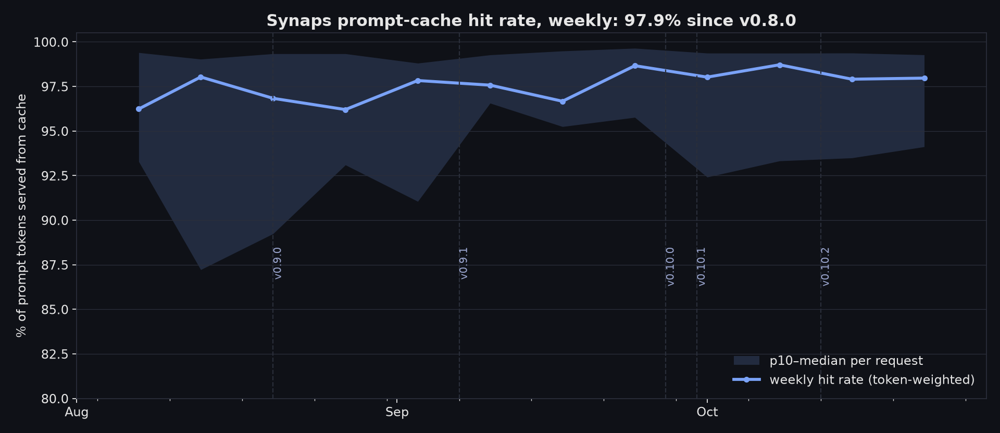

# Benchmarks

How Synaps measures startup latency and memory footprint, how to reproduce it,
and what the numbers were on the reference machine. Prompt-cache hit rates from
real use are in [`benchmarks/prompt-cache/`](benchmarks/prompt-cache/).

The harnesses live in [`benchmarks/`](benchmarks/). Methodology and portions of
their source are adapted from [jcode](https://github.com/1jehuang/jcode)'s
benchmark scripts (MIT, Jeremy Huang) — see [`benchmarks/NOTICE`](benchmarks/NOTICE).

## TL;DR

Measured 2026-10-26 on one machine, same day, current versions (details in
[Results](#results)).

- **Warm start ~7 ms** to first frame (attach to the running daemon), input
  echo ~8 ms.
- **Cold start ~41 ms** (the first launch spawns the daemon).
- **~4 MB per additional session.** The daemon amortizes.
- **Linear to 1000 sessions:** 1000 idle sessions in 4.7 GB, 4.1–4.8 MB each
  (0.11.1, 2026-11-05, [Scaling](#scaling-to-1000-sessions--synaps-0111)).
  Past ~170 sessions the daemon needs a higher open-files limit
  ([Limits seen at scale](#limits-seen-at-scale)).
- At 10 concurrent sessions Synaps used **less RAM than every other harness
  tested**: 79 MB, against 165 MB for jcode and 525–1197 MB for the rest.
- **97.9% of prompt tokens served from the Anthropic prompt cache** since
  v0.8.0, over 127k real requests (median request 99.4%). See
  [Prompt cache](#prompt-cache).

## Methodology

Both harnesses drive tools through a real pseudo-terminal (PTY), answer the
terminal-capability queries a TUI emits at boot (cursor position, device
attributes, color/OSC, synchronized-output, bracketed paste — without answering
these you measure the query timeout, not the tool), and render output through
the [`pyte`](https://pypi.org/project/pyte/) terminal screen model.

### Latency — `benchmarks/bench_latency.py`
Two user-visible metrics over N interactive launches:
1. **first-visible frame** — first rendered line with ≥3 alphanumerics.
2. **input-ready** — a probe string is injected on first-visible; time until it
   echoes back to the rendered screen.

Reports median + range over N runs (default 10).

> Synaps and other daemon-backed harnesses have **bimodal** latency: the first
> launch spawns the daemon (cold), later launches attach to it (warm). Both are
> reported below; run 1 is cold, runs 2–N are warm.

### Memory — `benchmarks/bench_memory.py`
Total **PSS + SwapPss** (from `/proc/<pid>/smaps_rollup`) summed across every
process a tool runs: daemon or server, workers, and every client. PSS rather
than RSS, because it splits shared pages proportionally, which is right for
multi-process and daemon designs (RSS would count shared pages once per
process). SwapPss is added because on a machine with zram/swap the kernel
swaps an idle TUI's pages out within seconds, and resident PSS alone then
reads lower the busier the machine is.

- **Every process counts, also detached ones.** Each launched process carries
  an environment marker; marked processes are summed even after they leave the
  launched process tree (`setsid`, double fork). This is how jcode's and
  opencode's background servers are counted.
- **Isolated state.** Synaps runs in an empty base dir (`SYNAPS_BASE_DIR`,
  default `/tmp/synaps-bench-home`, refused if it overlaps `~/.synaps-cli`),
  so no plugins: the core runtime. jcode runs with its own `JCODE_HOME` and
  runtime dir, opencode with its own XDG dirs and service port. None of them
  can attach to a server you already have running, which would leave that
  server uncounted. pi, codex and Claude Code have no background server and run
  with your normal config.
- **Sessions are idle.** The harness types a probe without Enter; no prompt is
  ever sent, so no API spend.
- **Quiet machine.** Each repetition waits for memory pressure (PSI
  `some avg10`) to fall to ≤1% and is retried if pressure rose while it was
  sampled. Under pressure the kernel evicts pages mid-sample.
- **Sample point.** 3 s after the last session is up (or its launch timed
  out), the same for every tool. `--hold N` samples later instead.
- The harness never touches a live daemon: it only stops the isolated one, and
  aborts if your default daemon's pid disappears.

## Reproduce

```bash
pip install pyte                       # only dependency beyond python3 + Linux

# Latency: run 1 is cold (spawns the isolated daemon), runs 2-10 warm
python3 benchmarks/bench_latency.py --runs 10 --tools synaps

# Memory at 1 and 10 concurrent sessions, 3 repetitions, raw JSON
python3 benchmarks/bench_memory.py --sessions 1 10 --reps 3 --timeout 10 \
  --tools synaps jcode jcode_memory_off pi codex opencode claude_code \
  --json-out memory.json

# A specific binary
SYNAPS_BIN=./target/release/synaps python3 benchmarks/bench_memory.py --sessions 10

# Scaling past 10 sessions (synaps only). The harness raises its open-files
# limit for the daemon it spawns; 1000 sessions also use ~1000 inotify
# instances of the running user (see Scaling)
python3 benchmarks/bench_memory.py --sessions 20 200 500 1000 --launch-wait 0.1 \
  --json-out scaling.json
```

## Results

**Date:** 2026-10-26, every number below on the same day.
**Machine:** Intel Core Ultra 9 275HX (24 cores), 30.7 GB RAM, zram swap,
CachyOS (Arch-based), Linux 7.2.11-1-cachyos, x86_64. A shared workstation
with other work running; see the quiet-machine gate above.
**Raw data:** every repetition, per-process PSS/SwapPss/anon/file, PSI and
versions are in [`benchmarks/results/`](benchmarks/results/).

### Latency — synaps 0.11.0 (5 × 10 launches)

| Phase | first-visible | input-ready |
|-------|--------------:|------------:|
| **warm** (attach to daemon) | **7.0 ms** (5.7–9.8, n=45) | **8.3 ms** (7.2–11.3, n=42) |
| **cold** (spawn daemon) | 40.6 ms (35.7–47.8, n=5) | 41.8 ms (37.1–49.6, n=5) |

Medians, range in brackets. A few launches' probe did not echo before the
timeout and are left out of input-ready (n<45).

### Memory — total PSS + SwapPss, median of 3

| Tool | Version | 1 session | 10 sessions | per added session |
|------|---------|----------:|------------:|------------------:|
| **synaps** (core, no extensions) | 0.11.0 | **41.5 MB** | **78.6 MB** | **~4.1 MB** |
| jcode (default config, memory on) | v0.91.0 (439a243bb) | 116.7 MB | 164.8 MB | ~5.3 MB |
| jcode (`JCODE_MEMORY_ENABLED=0`) | v0.91.0 (439a243bb) | 117.5 MB | 173.4 MB | ~6.2 MB |
| pi | 0.85.1 | 116.7 MB | 708.3 MB | ~65.7 MB |
| claude code | 2.1.304 | 185.7 MB | 894.0 MB | ~78.7 MB |
| codex | codex-cli 0.163.0 | 273.9 MB | 524.7 MB | ~27.9 MB |
| opencode | v2.1.1 | 387.1 MB | 1197.3 MB | ~90.0 MB |

"Per added session" is (10 sessions − 1 session) / 9. At 10 concurrent sessions
Synaps core used **2.1× less RAM than the next-lightest harness** (jcode) and
15× less than the heaviest (opencode). The daemon is why: sessions share one
runtime, so an added session is a thin client (~3.3 MB of the 10-session total
per client process).

Notes on individual rows:

- **jcode** starts `jcode serve` from its first TUI with `setsid`; later TUIs
  attach to it. Its memory switch is `[features] memory` in `config.toml`
  (default `true`) or `JCODE_MEMORY_ENABLED`; both settings are shown.
  jcode's server releases memory about two minutes after it starts (its idle
  heap trim), so its number depends on when you sample: one session read
  118 MB at launch and 86 MB after a 150 s hold.
- **jcode's own README** quotes ~3.3 MB per additional session. That figure
  is headless (sessions created over the server's debug socket by
  `scripts/bench_headless_memory.py`, no TUI). These are interactive TUI
  sessions over a PTY, each its own client process.
- **opencode** 2.x TUIs attach to a background `opencode serve --service`
  (220–270 MB of each total, counted although it is outside the launched
  process tree).
- **codex** never painted a frame the harness recognises within the 10 s
  launch timeout, so it is sampled at that point rather than after a frame.
- **antigravity** was not re-measured: only the Antigravity desktop IDE
  (2.24.0, Electron) is installed here, not a terminal CLI.
- Not installed on this machine: `cursor-agent`, GitHub Copilot CLI.

### Scaling to 1000 sessions — synaps 0.11.1

**Date:** 2026-11-05, same machine, CachyOS on Linux 7.3.0-4-cachyos. Idle
`--attach --new --keep-warm` sessions, no extensions, total PSS + SwapPss of
the daemon and every client. Raw data and the exact setup of each run:
[`benchmarks/results/memory-scaling-2026-11-05/`](benchmarks/results/memory-scaling-2026-11-05/).

| Sessions | Total | Per added session | Runs |
|---------:|------:|------------------:|------|
| 1 | 35.9 MB | – | median of 3 |
| 10 | 72.6 MB | 4.1 MB | median of 3 |
| 20 | 117.2 MB | 4.5 MB | 1 |
| 200 | 889.8 MB | 4.3 MB | 1 |
| 500 | 2,271 MB | 4.6 MB | 1 |
| 1000 | 4,674 MB | 4.8 MB | 1, in a container |

"Per added session" is the step from the row above. The cost per session
creeps up with the count (4.1 → 4.8 MB) but stays close to linear. Every
launched client was still running at each sample. For scale: 200 idle Synaps
sessions (890 MB) fit in what 10 Claude Code sessions used in the 2026-10-26
table above (894 MB). 1 and 10 sessions read lower here than in the 0.11.0
table above (41.5 / 78.6 MB), on a newer kernel too, so the drop isn't
attributed to either.

How these differ from the table above:

- **Single repetitions from 20 up,** and 20+ were launched 0.1 s apart
  (`--launch-wait 0.1`) instead of 4 s, so 1000 sessions take minutes and not
  over an hour. The sample is still taken 3 s after the last launch. Check:
  10 sessions read 72.6 MB at 4 s and 71.0 MB at 0.1 s.
- **Open-files limit raised to 65536** for 200 and up (below).
- **1000 ran in a container** (`ubuntu:24.04`, the same binary bind-mounted,
  same kernel, a separate uid), because every session holds an inotify
  instance and 1000 of them would use up the running user's
  `fs.inotify.max_user_instances` (1024 here) for every other program of that
  user. 10 sessions read 73.0 MB in the container.

#### Limits seen at scale

- **Open files.** The daemon holds about 5 file descriptors per session and
  doesn't raise its own `RLIMIT_NOFILE`. At the usual soft limit of 1024 it
  refuses new sessions at about 170 (`attach: refused: create session: Session
  error: Too many open files (os error 24)`), and the pins file stops being
  written (`pins: pin not written` in the log), so pins set after that point
  aren't saved. Workaround: `ulimit -n 65536` in the shell that starts
  the daemon. At 1000 sessions the daemon held 4,547 fds.
- **Inbox watchers.** Each session runs its inbox watcher
  (`crates/agent-engine/src/events/ingest.rs`) as a `spawn_blocking` task that
  never returns, holding one inotify instance and one blocking-pool thread that
  wakes every 500 ms. Tokio's blocking pool stops at 512 threads, and the
  1000-session run had 512 inotify instances: sessions past 512 get no watcher.
  From the code (not reproduced as a hang), any later `spawn_blocking` or
  `tokio::fs` work in the daemon then waits behind those 512 tasks.

### Compared with the previous table (Sept 2026)

The previous numbers came from older tool versions and a harness that had three
problems: it counted only resident PSS, it ran in the user's own state, and it
missed servers outside the launched tree. Its jcode server was orphaned after
each run and the next run attached to it uncounted (reproduced with the old
harness: 75.7 MB for 10 jcode sessions, TUIs only, server not counted). The old
jcode, opencode and codex rows are not comparable. Old Synaps rows: 38.8 / 68.5
MB.

## Prompt cache

Not a harness run: telemetry from real use. It covers every Anthropic request
Synaps made on the maintainer's two machines from v0.8.0 (Aug 4) to Oct 25,
2026, main sessions and subagents. The full report, charts and per-release, per-month
numbers are in
[`benchmarks/prompt-cache/`](benchmarks/prompt-cache/README.md).

| since v0.8.0 (Aug 4 → Oct 25, 2026) | |
|---|---|
| Prompt tokens served from cache | **97.9%** (median request 99.4%) |
| Requests | 127,453 (43.7k main sessions, 81.9k subagents) |
| Tokens read from cache | 27.35B |
| Share of the prompt re-written | 2.1% |
| List-price equivalent, with / without cache | $14.3k / $137.7k (89.6% cheaper) |
| Every release | 97.1% – 98.4% |

The dollar figures are list-price equivalents, not money spent.



## Caveats (read these)

- **Single machine.** Cross-machine comparison to any vendor's *published*
  numbers is unreliable — the same tools measured here differed substantially
  from their published figures (both directions). Only same-machine numbers are
  meaningful; reproduce on your own hardware.
- **Idle TUI sessions only.** Memory after real turns (history, tool output)
  grows for every tool and is not measured here.
- **When you sample matters.** Tools that trim their heap when idle read
  lower later (see jcode above). Every tool here is sampled at the same point.
- **No-auth state for the isolated tools.** Synaps, jcode and opencode run
  from empty state dirs (jcode shows its first-run welcome screen); pi, codex
  and Claude Code run with the user's config and login.
- **"Extensions off" is the core-runtime number.** Synaps runs extensions as
  separate, crash-isolated processes; each adds a fixed footprint that does not
  scale with sessions. The previous estimate of ~24 MB per extension is from
  September 2026 (v0.9.x) and was not re-measured.
- **Latency vs other daemon harnesses is not settled here.** Only Synaps
  latency was re-measured.
- **What is *not* measured here:** time-to-first-token, cost-per-task, and task
  success. First-frame latency and idle RAM are necessary, not sufficient.
- **The prompt-cache numbers are one heavy user's workload** (daily
  development of Synaps itself, mostly Claude, many subagents). Your hit rate
  depends on how you work: long pauses past the cache TTL cost a rebuild.
