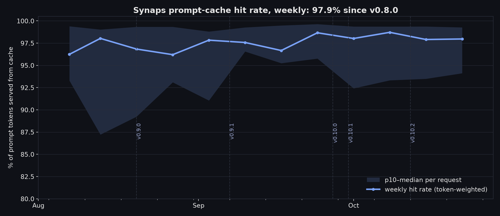

<p align="center">
  
</p>

<h3 align="center">Lightning-fast agent runtime</h3>

<p align="center">
  <a href="https://github.com/HaseebKhalid1507/SynapsCLI/actions/workflows/ci.yml"></a>
  <a href="https://crates.io/crates/synaps"></a>
  <a href="LICENSE"></a>
  <a href="https://discord.gg/JCdgRYqVDP"></a>
  <a href="https://ratatui.rs/"></a>
</p>

<p align="center">
  Run a crew of AI agents in your terminal, on any model, from one ~32 MB binary.
</p>

<p align="center">
  
</p>

<!-- BENCH-STRIP: numbers from BENCHMARKS.md; update both together -->
| **79 MB** for 10 sessions | **~7 ms** to first frame | **97.9%** of prompt tokens from cache |
|:---:|:---:|:---:|
| next lightest (jcode) 165 MB, Claude Code 894 MB | on a warm daemon; cold start ~41 ms | 127k real requests since v0.8.0, 89.6% cheaper |

<p align="center"><sub>Same machine, same harness, versions and method in <a href="BENCHMARKS.md">BENCHMARKS.md</a>.</sub></p>

---

## Install

Linux and macOS.

```bash
curl --proto '=https' --tlsv1.2 -LsSf https://github.com/HaseebKhalid1507/SynapsCLI/releases/latest/download/synaps-installer.sh | sh
# or
brew install HaseebKhalid1507/tap/synaps

synaps --version    # check it worked
```

<details>
<summary>Other ways: cargo, AUR, .deb, source</summary>

```bash
cargo install synaps                        # crates.io, needs Rust 1.88+
yay -S synaps                               # Arch / EndeavourOS

# Debian/Ubuntu: a .deb is attached to every release
# https://github.com/HaseebKhalid1507/SynapsCLI/releases/latest

git clone https://github.com/HaseebKhalid1507/SynapsCLI && cd SynapsCLI
cargo build --release && ./target/release/synaps
```
</details>

## Quick start

```bash
synaps login     # pick a provider: your subscription, an API key, cloud, or local
synaps           # start the TUI
```

Sign in with what you already pay for, or use no account at all:

```bash
synaps login --provider claude      # Claude subscription (also openai-codex, xai-auth, github-copilot)
synaps login --provider kimi        # an API key
ollama serve                        # or a local model: run synaps, then /model local/llama3.2
```

<details>
<summary>All providers, cloud identity and local endpoints</summary>

```bash
# Subscription OAuth
synaps login --provider claude
synaps login --provider openai-codex
synaps login --provider xai-auth
synaps login --provider github-copilot
synaps login --provider google-gemini  # requires a Synaps-owned Google Desktop OAuth client registration

# Static API key
synaps login --provider kimi            # Moonshot AI (MOONSHOT_API_KEY / KIMI_API_KEY)

# Cloud identity; credentials stay in the broker
synaps login --provider azure-openai
synaps login --provider aws-bedrock
synaps login --provider google-vertex
```

Models are provider-qualified: `/model <provider>/<model>`. Cloud routes (Azure OpenAI, Amazon Bedrock, Google Vertex AI) are text-only for now and say so in model listings; a mode that needs tools fails before any credential is used. Availability depends on each upstream account, region and quota.

Local models: Synaps targets Ollama's default `http://localhost:11434/v1`. LM Studio, vLLM and llama.cpp work too; point at them with `provider.local.url` or `LOCAL_ENDPOINT`. Several accounts per provider: [docs/providers/multi-account-broker.md](docs/providers/multi-account-broker.md).
</details>

## What it does

- **Sessions outlive the window.** A background daemon owns every session. `/sessions` lists them, and pinned ones come back after a restart. [More](docs/daemon-mode.md)
- **Every terminal is you.** Attach several clients to one session; any of them can type, steer, or take over.
- **Run a crew.** Named subagents work in parallel. Open any one in its own view and steer it mid-flight. [More](docs/subagent-watch.md)
- **Any model.** Claude, Codex, Grok, Copilot, Gemini, Kimi, [Meta Muse](docs/providers/muse.md), Azure, Bedrock, Vertex, any OpenAI-compatible endpoint, or Ollama.
- **Credentials stay in the broker.** Agents get short-lived, scoped tokens, never your keys. Several accounts per provider. [More](docs/providers/multi-account-broker.md)
- **Bounded turns, when you want them.** Optional caps on rounds, tool calls, time, tokens and cost.
- **Memory that survives.** Project memory, `/compact` checkpoints, sessions that chain across days.
- **Sees what you see.** The model reads images, and `/attach` adds images, PDFs and text to a turn. [More](docs/multimodal.md)
- **Build on it.** Extensions in any language, MCP servers, and the engine over [JSON-RPC](docs/rpc-protocol.md) or WebSocket.

<p align="center">
  
</p>
<p align="center"><sub>Two terminals, one live session: the left one asks, the right one steers mid-turn.</sub></p>

## Benchmarks

<!-- BENCH-TABLE: from BENCHMARKS.md; update both together -->
Memory is total PSS (plus swapped-out pages) across each tool's whole process tree, background servers included, with idle TUI sessions. Measured 2026-10-26 on one machine (24 cores, 30 GB, Linux), median of 3. Synaps shares one daemon across sessions, so each extra session is a thin client.

| Memory | 1 session | 10 sessions | per extra session |
|--------|----------:|------------:|------------------:|
| **synaps** 0.11.0 (core) | **42 MB** | **79 MB** | **~4.1 MB** |
| jcode v0.91.0 | 117 MB | 165 MB | ~5.3 MB |
| pi 0.85.1 | 117 MB | 708 MB | ~66 MB |
| claude code 2.1.304 | 186 MB | 894 MB | ~79 MB |
| codex 0.163.0 † | 274 MB | 525 MB | ~28 MB |
| opencode 2.1.1 | 387 MB | 1197 MB | ~90 MB |

† codex never drew a frame the harness recognises within its 10 s timeout, so it was sampled at the timeout and may not have finished starting.

**Prompt cache, from real use:** 97.9% of prompt tokens came from cache across 127,453 requests since v0.8.0, every release between 97.1% and 98.4%. That's 89.6% cheaper than the same tokens at list price without caching. [Full report](benchmarks/prompt-cache/README.md)



Method, tool versions, latency numbers, caveats and how to reproduce: [BENCHMARKS.md](BENCHMARKS.md).

## Why Synaps

- **Agents are programs, not chat.** They happen to use language models. Run them like services.
- **Own your agent.** The system prompt is a file on disk, the tool list is opt-out, and nothing phones home.
- **Multi-agent is the default.** Single-agent is just n=1.
- **Speed is a feature.** A 2-second boot loses the dev who wanted it in a git hook.
- **The terminal is the IDE.** Built for people who already live there.

**Not for you if:**
- you're on Windows. It isn't supported.
- you want an IDE plugin or a desktop app. Synaps is terminal-first.
- you need a sandbox. Tools run as you; see [Security](#security).
- you want a settled tool. Synaps is young and moves fast; read the [upgrade notes](docs/upgrading/) before upgrading.

## Commands

| Command | What it does |
|---------|-------------|
| `synaps` | The TUI, a thin client on the shared daemon (started on first launch) |
| `synaps attach` | A line client attached to a daemon session |
| `synaps daemon` | `status`, `sessions`, `pin`, `stop`, `reload` (swap the binary, sessions intact), `reload-extension` |
| `synaps send` | Send a message to a running session from a script |
| `synaps chat` | The same engine on stdin/stdout, for pipes, scripts and CI |
| `synaps rpc` | JSON-RPC over stdio, to embed the engine in other software |
| `synaps server` | WebSocket API with token auth and streaming |
| `synaps login` · `auth` · `status` | Sign in, manage several accounts per provider, see usage and reset windows |

## Configuration

One file, `key = value`, at `~/.synaps-cli/config`:

```ini
model = anthropic/claude-opus-5
thinking = high
theme = tokyo-night
identity = You are a senior engineer who writes clean, tested code.
disabled_tools = bash, ls          # remove built-ins at boot (read-only profiles)
```

Every key, the multi-machine auth broker and more are in the [Wiki](https://github.com/HaseebKhalid1507/SynapsCLI/wiki).

## Extensions

Drop a folder in `~/.synaps-cli/plugins/` and it's live on next boot:

```
~/.synaps-cli/plugins/my-guard/
├── .synaps-plugin/plugin.json    # manifest: hooks, permissions, keybinds
└── main.py | index.js | <any>    # JSON-RPC 2.0 over stdio, any language
```

Each extension is its own crash-isolated process, with a permissions manifest that gates what it can touch, and hooks from `before_tool_call` to `on_session_end`. Restart one without touching your sessions: `synaps daemon reload-extension <name>`. Protocol and tutorial: [docs/extensions/](docs/extensions/).

## Themes

21 built-in themes, including `catppuccin`, `gruvbox`, `nord`, `tokyo-night`, originals like `neon-rain` and `night-city`, and a light one, `paper`. Switch live with `/theme`, or try one for a single run with `SYNAPS_THEME=<name>`.

<p align="center">
  
  
  
</p>

## Security

- **Credentials live in a broker.** Agents get short-lived, scoped tokens, so a compromised agent can't leak what it never held. Thin clients strip secrets from your shell's environment before connecting.
- **Extensions are fenced.** Each runs as its own process under a permissions manifest, and a tool-call confirm names the extension that asked ([details](docs/confirm-prompts.md)).
- **The daemon is yours alone.** Its socket is owner-only and refuses other users.
- **Not a sandbox.** Tools run as you. Building with `--no-default-features` compiles out `bash` and the `shell_*` tools, but an agent can still start processes indirectly: by editing shell rc files or MCP config, or through extensions. Use a container or VM for untrusted work.

Found a vulnerability? Report it privately: [SECURITY.md](SECURITY.md).

## Docs and help

- **New to agents?** Start with the [ELI5](ELI5.md).
- **The full tour:** the [Wiki](https://github.com/HaseebKhalid1507/SynapsCLI/wiki), and the reference docs in [docs/](docs/README.md).
- **Upgrading:** [docs/upgrading/](docs/upgrading/) and the [CHANGELOG](CHANGELOG.md).
- **Stuck?** Ask in the [Discord](https://discord.gg/JCdgRYqVDP) or open an [issue](https://github.com/HaseebKhalid1507/SynapsCLI/issues).

## Contributing

Synaps is young and moving fast. Good first contributions: a new provider, an extension, a theme, docs, or any [`good first issue`](https://github.com/HaseebKhalid1507/SynapsCLI/labels/good%20first%20issue).

```bash
git clone https://github.com/HaseebKhalid1507/SynapsCLI && cd SynapsCLI
cargo build && cargo test
```

Read [CONTRIBUTING.md](CONTRIBUTING.md) and [ARCHITECTURE.md](ARCHITECTURE.md) first. Issues and PRs are welcome, and the maintainer answers fast. Come hang out in the [Discord](https://discord.gg/JCdgRYqVDP): questions, ideas, show-and-tell, or just to watch the crew run.

## License

Apache 2.0. See [LICENSE](LICENSE).

<p align="center">
  <sub>Synaps is built with Synaps.</sub>
</p>

<!--  Never Fade Away  -->
