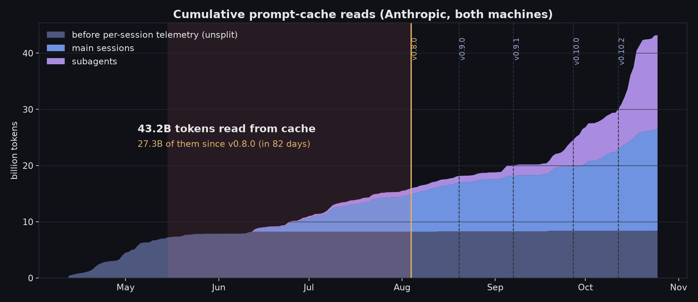
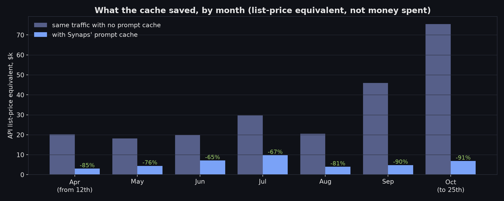
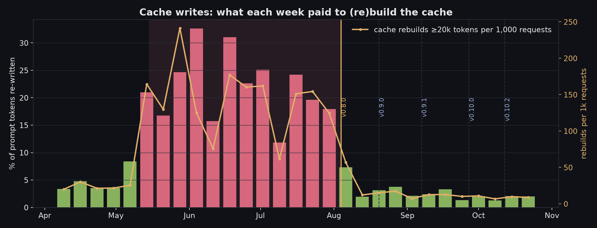

# Prompt cache: hit rate since v0.8.0

Real usage, not a synthetic benchmark. These numbers cover every Anthropic
request Synaps made on the maintainer's two machines from Apr 12 to Oct 25,
2026: main sessions, subagents and watchers, during daily development of
Synaps itself. The focus is v0.8.0 onwards (Aug 4 → Oct 25, 82 days, 79 of
them active). The data stops at the end of the 0.10.2 cycle.

- **Charts:** [`charts/`](charts/), rebuilt from the numbers with
  `python3 charts.py` (needs matplotlib).
- **Numbers:** [`stats.json`](stats.json), with every aggregate below by
  release, month, week, day and role.
- **Raw logs:** not published. They are private usage logs. See
  [Method](#method) for how they were turned into `stats.json`.

## Headline numbers (since v0.8.0)

| | |
|---|---|
| Prompt tokens served from cache | **97.9%** (token-weighted). The median request reads **99.4%**. |
| Anthropic requests | **127,453**: 43.7k main sessions, 81.9k subagents, 1.8k unattributed |
| Tokens read from cache | **27.35 billion** (43.2B since Apr 12) |
| Tokens written to cache | 585M (2.1% of prompt tokens) |
| Uncached input | 5.4M (0.02%) |
| API list-price equivalent | **$14.3k** with the cache vs **$137.7k** without it: **89.6% cheaper** |
| Every release since v0.8.0 | 97.1% – 98.4% |

The dollar figures are list-price equivalents, there for comparison. The
traffic ran on a subscription, so this is not money spent.

## Before vs after v0.8.0

| | Apr 12 – Aug 3 | **Aug 4 – Oct 25** |
|---|---|---|
| requests | 110,814 | 127,453 |
| hit rate (token-weighted) | 86.1% | **97.9%** |
| p10 request hit rate | 16.5% | **93.4%** |
| share of prompt re-written | 13.9% | **2.1%** |
| full rebuilds (≥20k tokens written) per 1k requests | 79 | **10** |
| tokens read from cache | 15.8B | **27.4B** |
| tokens written | 2.56B | **0.59B** |
| list-price equivalent: with / without cache | $25.5k / $92.3k (−72%) | **$14.3k / $137.7k (−90%)** |

Since v0.8.0, Synaps sent 1.5× the prompt volume of the earlier period while
writing **4.4× fewer** cache tokens.

## By release

| release (by tag time) | dates | requests | hit rate | median | p10 | re-written | reads | saved |
|---|---|---|---|---|---|---|---|---|
| before 0.8.0 | Apr 12 – Aug 4 | 110,814 | 86.1% | 98.8% | 16.5% | 13.9% | 15.8B | 72% |
| **0.8.0** | Aug 4 – Aug 20 | 9,114 | 97.3% | 99.2% | 89.5% | 2.7% | 2.2B | 84% |
| 0.9.0 | Aug 20 – Sep 7 | 11,392 | 97.1% | 99.0% | 91.4% | 2.8% | 2.0B | 89% |
| 0.9.1 | Sep 7 – Sep 27 | 17,827 | 97.9% | 99.5% | 95.4% | 2.1% | 4.1B | 88% |
| 0.10.0 | Sep 27 – Sep 30 | 7,391 | 97.9% | 99.4% | 92.0% | 2.1% | 2.2B | 91% |
| 0.10.1 | Sep 30 – Oct 12 | 15,739 | **98.4%** | 99.3% | 92.3% | 1.6% | 3.7B | 91% |
| 0.10.2 | Oct 12 – Oct 25 | 65,990 | 97.9% | 99.4% | 93.9% | 2.0% | 13.2B | 91% |

Most traffic came from development builds, which run ahead of the latest tag.
Read each row as "while vX was the newest release".

## By month, with cumulative reads

| month | requests | hit rate | reads | writes | **cumulative reads** | with cache | without | saved | subagent share of reads |
|---|---|---|---|---|---|---|---|---|---|
| Apr (from 12th) | 25,623 | 96.4% | 4.06B | 151M | 4.1B | $3.0k | $20.3k | 85% | — |
| May | 30,780 | 88.7% | 3.80B | 485M | 7.9B | $4.4k | $18.2k | 76% | — |
| Jun | 19,295 | 78.5% | 2.91B | 796M | 10.8B | $7.1k | $19.9k | 65% | ≥10% |
| Jul | 30,096 | 81.6% | 4.52B | 1,023M | 15.3B | $9.7k | $29.7k | 67% | ≥14% |
| Aug | 16,353 | 94.6% | 3.47B | 198M | 18.8B | $4.0k | $20.5k | 81% | ≥8% |
| Sep | 34,706 | 97.9% | 7.70B | 162M | 26.5B | $4.8k | $46.0k | 90% | 68% |
| Oct (to 25th) | 81,414 | 98.0% | 16.72B | 332M | **43.2B** | $6.8k | $75.4k | 91% | 61% |

"—" and "≥" mark months when per-session telemetry was off on one or both
machines, so subagent traffic can't be fully separated there (see
[Method](#method)).

**Volume went up about 5× and the hit rate held.** October alone read 16.7B
tokens, more than April–July combined. The week of Oct 12 had 54.6k requests
(the previous record week had 17.4k) at 97.9%. Subagents now account for about
60% of all cache reads. Their hit rate since v0.8.0 (98.0%) is slightly higher
than that of main sessions (97.8%).

## What changed: the v0.8.0 cache fix

**April ran at 95–97%. From May 15 to Aug 3, a bug re-wrote the entire
conversation on almost every user turn.**

- **What went wrong:** per-turn extension context (memory recall, the current
  time, task pins) was appended to the **system prompt**. Anthropic's cache
  prefix is ordered tools → system → messages. Changing the end of the system
  prompt on every turn invalidated the whole cached history after it, every
  turn.
- **The fingerprint in the data:** in active sessions (same conversation,
  previous turn under 5 minutes earlier), the cache read collapsed to the
  exact size of the tools + system block. The same values repeat hundreds of
  times: 9,001 tokens ×803, 5,977 ×722, 9,171 ×582, 10,033 ×556.
- **Cost:** 5,712 such rewrites, **1.64B tokens re-written**, about **$9.8k
  list-price equivalent**. That is **half of all spend** in the bug window.
  Without it, the window's hit rate would have been about 95.5% instead of
  80.5%.
- **Fix:** [#81](https://github.com/HaseebKhalid1507/SynapsCLI/pull/81),
  merged Aug 3 and shipped in **v0.8.0** on Aug 4.
  - `abaf3378`: per-turn injection now goes on the newest user message, the
    uncached tail, so it can't break the cache.
  - `f5358a90`: the cache marker is stamped on the last durable block, not on
    the ephemeral injected tail.
- **Result:** Aug 3 had 191 tools+system-only rewrites. **Aug 4 had zero**, and
  the pattern has not come back.

**Aug 7: one machine's `cache_ttl` went from 5m to 1h.** This was a config
change; the default is still `5m`. A pause of up to an hour between turns
stopped costing a rebuild there. That change plus the fix took the weekly hit
rate from 82% (week of Jul 27) to 98% (week of Aug 10).

**After that, steady improvements:**
- 0.10.1 is the best release in this window, at 98.4%.
- Keep-warm (`cache_keepwarm`,
  [#205](https://github.com/HaseebKhalid1507/SynapsCLI/pull/205)) shipped in
  0.10.2. It's opt-in, and it was on for part of October.
- 0.11.0 fixes two leaks found in this data: a daemon reload or park dropped
  the session's activated tools and re-wrote the prefix
  ([#294](https://github.com/HaseebKhalid1507/SynapsCLI/pull/294)), and
  cache totals reset on reload or resume
  ([#295](https://github.com/HaseebKhalid1507/SynapsCLI/pull/295)).

## Where the remaining ~2% goes (since Aug 7)

Since Aug 7, Synaps has written 566M cache tokens. 355M of that came from full
rebuilds (≥20k tokens written, reading less than was written). The table
assigns each rebuild to the conversation's previous turn, matched by prompt
size, since prompts only grow within a conversation. Treat the split as
approximate.

| cause (proxy) | main sessions | subagents |
|---|---|---|
| idle 5 min – 1 h, then resumed | 38M | **91M**: subagents are pinned to the 5m TTL ([#57](https://github.com/HaseebKhalid1507/SynapsCLI/pull/57)) |
| active session, prefix changed (reload, tool/schema change, rollover) | 59M | 55M |
| idle > 1 h (1h TTL expired) | 38M | 18M |
| new session / resume / rollover with no predecessor | 41M | 12M |

The largest bucket is subagents going idle for 5 minutes to an hour, usually
while waiting on long builds. **A 1h TTL for subagents would not pay off.**
The 1h write premium on every subagent write would cost about $1,149 to avoid
about $482 of rewrites, so the 5m policy stays.

## Method

**Two sources, merged per request:**
- `~/.cache/synaps/api-log.jsonl` (written when `telemetry = basic` or
  `full`): model, the 5m/1h write split and the request id. Before 0.11.0 it
  covered **main sessions only**, because subagent runtimes didn't inherit the
  telemetry level. The log runs from Jun 12 on machine A and from Sep 20 on
  machine B.
- The daily `~/.synaps-cli/synaps.log.*` files: a `Token Usage:` DEBUG line
  for **every** Anthropic response, subagents included. That's 188 days on
  machine A (Apr 12 → Oct 15, after which it stopped running Synaps) and 112
  on machine B. These lines carry no model.

**How they were merged:**
- 98.3% of api-log rows match a log line (same input/read/write, within
  120 s). Matched lines are labelled **main**. Unmatched log lines inside a
  machine's api-log window are labelled **subagent**; outside it they are
  **unattributed**. The 1,183 api rows with no log line are kept as main.
- Builds before Jun 14 logged each request twice (fixed in `6811a66d`).
  Identical lines within 600 s are collapsed before that date only, which
  removed 63.1k lines.

**Metrics and pricing:**
- **Hit rate** = cache read ÷ (uncached input + cache read + cache write),
  weighted by tokens. "Median" and "p10" are per-request hit rates.
- **Prices** are the list prices in
  [`crates/agent-core/src/pricing.rs`](../../crates/agent-core/src/pricing.rs):
  read 0.1×, 5m write 1.25×, 1h write 2× of the input price.
- **Subagent cost is an estimate.** Subagent log lines have no model. Each
  one gets a model from that machine-day's `Starting API request model=`
  counts minus the main-session requests, and is priced with 5m writes, which
  subagents have used since Jul 1.

**Exclusions:**
- **Anthropic only.** Codex/OpenAI traffic doesn't produce this usage line.
- 7 keep-warm pings (by design they only read the cache).
- 398 failed requests with empty prompts.

## Measuring your own

Since 0.11.0, subagent requests are written to `api-log.jsonl` too
([#303](https://github.com/HaseebKhalid1507/SynapsCLI/pull/303)), so the
telemetry log alone covers every Anthropic request, without the DEBUG-log
matching above. Turn it on with `telemetry = basic` in your config. Every row
of `~/.cache/synaps/api-log.jsonl` carries the uncached input, cache read and
cache write counts that the hit rate above is computed from.
