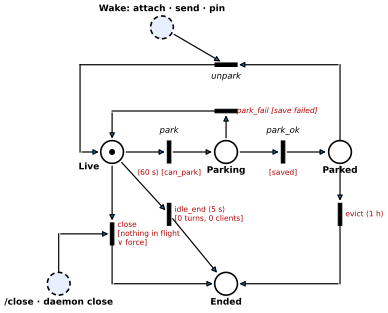
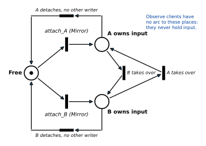
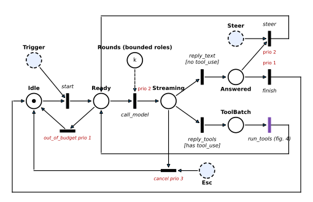
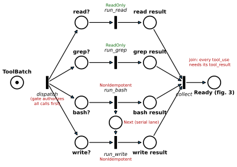
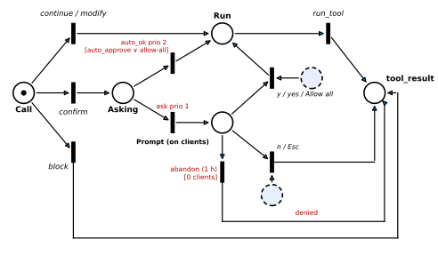
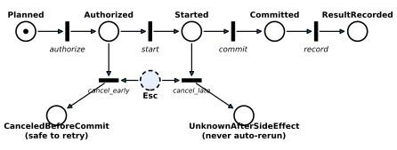
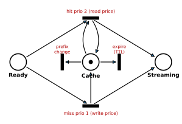
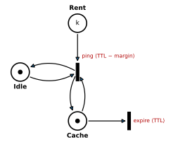

# Synaps as a Petri net

A formal picture of how a daemon session, a turn, a tool batch and a single tool call behave, and how the prompt cache sits next to them. Use it as a map of the invariants. It models behaviour, not code: where the two disagree, the code is right and this page is stale.

Modelled from `dev` at `68423cdc`. The figures are generated by [`petri-net/gen.py`](petri-net/gen.py) (`python3 docs/petri-net/gen.py`, needs matplotlib).

## Reading the diagrams

| Symbol | Meaning |
|---|---|
| circle (**place**) | a condition or a resource, e.g. "the session is parked", "a reply is waiting" |
| dot (**token**) | the condition holds right now. A number or `k` means that many tokens. |
| bar (**transition**) | an event. It is **enabled** when every input place holds a token, and **firing** it takes one token from each input and puts one in each output. |
| dashed blue circle | an **environment place**: someone outside the net puts tokens there (a client, the user, another process) |
| `[guard]` | the transition may fire only while the guard is true |
| `prio n` | among the enabled transitions, only those with the highest priority may fire. Used here as an "else": the low-priority branch fires only when the high-priority one can't. |
| `⟨d⟩` | timed: the transition fires `d` after it became enabled. If a firing takes a token from one of its inputs and puts it back, the timer starts over. |
| dashed arc | applies to some roles or modes only |

The nets nest: daemon → session (§1, §2) → turn (§3) → tool batch (§4) → tool call (§5, §6). The prompt cache (§7) lives at the provider, next to all of them.

## 1. A session in the daemon

`SessionLifecycle` (`session/types.rs`) is `Live | Parking | Parked | Ending`. Exactly one of Live, Parking, Parked and Ended holds the token.

| Transition | Guard / time | What happens | Code |
|---|---|---|---|
| park | `⟨60 s⟩` after the last detach, `[can_park]` | Starts the save and the PTY teardown | `SessionActor::can_park`; `SYNAPS_DAEMON_PARK_GRACE_SECS` |
| park_ok | `[saved]` | Drops `Runtime` and `ConversationState`; the background tasks stay | `SessionActor::park` |
| park_fail | `[save failed]` | The session stays live | |
| unpark | needs a Wake | Rebuilt from the journal on an attach, an event on the session's socket (`synaps send`, agent-comms, a worker's wake) or a pin | `SessionActor::unpark` |
| evict | `⟨1 h⟩` while parked | `Ended(Evicted)`. The journal stays, and `--continue` rebuilds the session. | `SYNAPS_DAEMON_PARKED_EVICT_SECS` |
| idle_end | `⟨5 s⟩`, `[0 turns, 0 clients]` | `Ended(Idle)` (F18). There is nothing to journal, so the session can't park. | `SYNAPS_DAEMON_IDLE_END_GRACE_SECS` |
| close | `[nothing in flight ∨ force]` | `Ended(ClientQuit)`. A parked session closes the same way, without being rebuilt. | `/close`, `synaps daemon close` |

**`can_park` is a guard over the other nets.** It holds only with:
- no clients attached;
- no turn streaming (§3);
- no compaction;
- no pending prompt (§5);
- a non-empty history and nothing queued;
- no pin;
- persistence on;
- no armed driver;
- no worker holding the park;
- no active cache keep-warm period (§7).

A pin is a guard on park, evict and idle_end. Pinning a parked session fires unpark.

**The daemon's own idle exit** reads every session's marking. An auto-spawned daemon exits 10 s after the last disconnect, but only with zero clients, no turn running and no pinned session. It never exits under a running turn.

## 2. Who owns input

**There is one input token.** `Free + A owns + B owns = 1` is an invariant, so a session never has two input owners (`AttachMode`, `SessionActor::input_owner`).

**How each attach mode treats the token:**
- **Mirror** takes the token only if it is in Free. Otherwise the client joins without input.
- **Takeover** moves the token from the current owner, who gets `InputOwnerChanged{Takeover}`.
- **Observe** has no arc to these places, so an observer never holds input.

**When the owner detaches**, the token goes to the oldest attached non-Observe client (the same arcs as a takeover), or back to Free if there is none.

**What needs the token.** Each of these reads it without consuming it:
- every input command from a client (`is_input_command`, `session/actor.rs`): `Submit`, `Steer`, `Cancel` (Esc), `Compact`, settings changes, `/close`, `/pin on|off`, plugin and engine commands;
- choosing "Allow all" on a confirm;
- taking files from the shared inbox, which a session does only while some client owns its input.

A plain y/n answer to a confirm doesn't need the token: any non-Observe client can give it. The host (`synaps daemon close`/`pin`, the cost cap, `daemon stop`) acts with host authority and needs no token.

**Detach has no arc into the turn net.** Ctrl+C detaches and the turn keeps running in the daemon. Esc is what cancels (§3).

## 3. One turn

One control token moves through Idle → Ready → Streaming → Answered or ToolBatch, so a session runs one turn at a time. Events that arrive mid-turn are steered into it or buffered; they never start a second turn.

**Where Trigger tokens come from** (`TurnTrigger`):
- `User`: a Submit from the input owner;
- `QueuedAuto`;
- `EventAuto`: an event-queue wake from `synaps send`, the inbox or a finished worker;
- `DriverAuto`, `PluginCommand` and `Compaction`.

A Steer token comes from the input owner, or from an event that arrives while a turn streams (`WakeAction`, `engine/reactor.rs`).

| Transition | Inputs → outputs | Priority | Code (`runtime/stream.rs` unless noted) |
|---|---|---|---|
| start | Idle + Trigger → Ready | – | the session actor starts a turn |
| call_model | Ready + Rounds → Streaming | 2 | `budget_meter.begin_round()`, then the request. Rounds exist only for bounded roles: Event and Autonomous get 24 with no renewal, Worker gets 64 with 2 renewals, Foreground has no round cap (`TurnBudget::for_role`, `runtime/budget.rs`). |
| out_of_budget | Ready → Idle | 1 | fires only when call_model can't: Rounds is empty and the renewals are used up, giving `BudgetExceeded` |
| reply_text / reply_tools | Streaming → Answered / ToolBatch | – | guard on the reply's content: does it have `tool_use` blocks? |
| run_tools | ToolBatch → Ready | – | the whole of §4 |
| steer | Answered + Steer → Ready | 2 | `drain_steering()`. A waiting message continues the turn instead of ending it. Steering is also drained before every request (not drawn). |
| finish | Answered → Idle | 1 | the "else" of steer. The subagent completion gate can refuse it (not drawn). |
| cancel | Streaming + Esc → Idle | 3 | an Esc from the input owner (§2), or a host cancel (cost cap, `daemon stop`, reload), see below |

**What cancel keeps.** The partial assistant message, every completed round and a labelled canceled `tool_result` for each unfinished call are kept as real history, followed by one interruption marker (`engine::interrupt`). A turn that had already finished when the cancel arrived ends normally (`Done`).

**When the session is saved.** Each completed round's history is published and saved by the actor's background writer (`session::persister`). The actor announces Idle only after the end-of-turn save.

## 4. Inside run_tools: fork, lanes, join

The example batch is four calls: `read` and `grep` (ReadOnly), then `bash` and `write` (NonIdempotent).

| Piece | Petri-net pattern | Code (`runtime/stream.rs`) |
|---|---|---|
| dispatch | fork: 1 token becomes n | EXECUTION GATE: all sibling calls are authorized under one registry read guard *before* any of them runs. Parse errors and denials become instant results. |
| run_read ∥ run_grep ∥ run_bash | concurrency: no shared input places | `LaneKind::Concurrent`: one `JoinSet` task per ReadOnly call |
| Next | a turn token, not a mutex | `LaneKind::Serial`: NonIdempotent, keyless and unclassified calls share one lane in **model order**. A mutex would let `write` run before `bash`. IdempotentWrite calls with a concurrency key get a lane per key. |
| collect | join over all n results | "We must always produce a tool_result for every tool_use"; otherwise the next request is rejected |

**Confirm prompts (§5) run inside the lane,** so a waiting prompt holds up only its own lane.

**Cancellation keeps the join alive.** Synaps writes a canceled result for every call that didn't finish, so collect can still fire and the history stays valid. Without that, the net would deadlock at collect.

**A single call skips the lanes** and runs inline.

## 5. One call: the before_tool_call hook and the confirm prompt

**The hook.** A `before_tool_call` extension hook (permission `tools.intercept`, see [extensions/hooks.md](extensions/hooks.md)) answers `continue`, `modify`, `block` or `confirm`. The first `block`, `confirm` or `modify` ends the handler chain.

**Skipping the prompt.** `auto_ok` (prio 2) fires when `server.auto_approve_confirms` is set, or when the session's Allow-all latch covers the asking extension.

**Asking.** Otherwise `ask` raises a `Prompt{Confirm}` titled "Confirm tool call" on every attached client (`resolve_before_tool_call_result`, `runtime/mod.rs`).

**How the prompt resolves:**
- `y`/`yes` runs the call.
- `Allow all` (input owner only) also arms the latch.
- Anything else blocks with "Tool call confirmation denied".
- With no interactive prompt available at all, the call is blocked.

**Answers race.** Several clients can answer, and the first answer wins. `answer` dedups on the prompt id, and `PromptResolved` dismisses the dialog everywhere else.

**Nobody attached.** abandon `⟨1 h⟩`: when a prompt is pending, no client is attached and no driver is armed, every pending prompt is denied after `daemon.prompt_abandon_secs` (default 3600, env `SYNAPS_DAEMON_PROMPT_ABANDON_SECS`). That makes `can_park` true again.

`tools.activation_confirm = prompt` uses the same Prompt path for `activate_tools`.

## 6. One call's ledger

**A straight sequence.** `CallPhase` (`tools/ledger.rs`) only moves forward: `Planned → Authorized → Started → Committed → ResultRecorded`. A skip or a backward step is rejected and never applied.

**A real conflict.** With the call in Started and an Esc token waiting, both `commit` and `cancel_late` are enabled and compete for the Started token. The code races them with `tokio::select!`: the tool future against `cancel.cancelled()`.

**Why there are two cancel exits:**
- **cancel_early** (before Started): nothing has happened yet, so the call is `CanceledBeforeCommit` and safe to retry.
- **cancel_late** (after Started, NonIdempotent tool): the side effect may already have happened. The call is `UnknownAfterSideEffect`, the turn ends as `InterruptedAfterSideEffect`, and the call is never rerun automatically.

ReadOnly and idempotent calls stay plain cancels.

## 7. The prompt cache

The Cache place is the provider's cached prefix. It covers tools → system → messages, with markers on the last tool, the last system block and the last message (single-last; see [specs/cache-ttl-spec.md](specs/cache-ttl-spec.md) §2.1).

**hit and miss.**
- hit (prio 2) is a self-loop on Cache. Each hit therefore restarts `expire`'s timer: the TTL runs from the start of the request that read the entry.
- miss (prio 1) is the "else": with no Cache token, the request writes the prefix and creates the token.
- `cache_ttl` is `5m` (the default), `1h` or `hybrid`.

**Only two transitions remove the token:** expire, and prefix_change.
- **prefix_change** covers anything that rewrites the front of the request: compaction or rollover, and a change of model, thinking, effort, tools or system prompt.
- The rest of the design keeps changes at the tail:
  - activatable tools are sent with `defer_loading` and sit outside the cached prefix ([request-lifecycle-progressive-disclosure.md](request-lifecycle-progressive-disclosure.md));
  - the tool catalog text is frozen per session;
  - steering, memory recall and hook injections go at the tail;
  - a cancel appends a marker instead of rewriting history;
  - crash recovery only appends.
- `cache_diagnostics = true` asks the provider why a request missed.

**The daemon doesn't touch the cache.** The cache lives at the provider, so detach, park and `daemon reload` don't remove the token. A session resumed within the TTL, with the same prefix, still hits.

**Keep-warm** (`cache_keepwarm`, off by default; `/keepwarm`; `session/cache_keepwarm.rs`, spec §7) is a timed transition.
- **When ping fires.** ping needs Idle + Cache + Rent and fires at TTL − margin (4.5 min for 5m, 55 min for 1h). It is a self-loop on Idle and on Cache, so each ping restarts its own timer and `expire`'s.
- **Why it wins the race.** Its time is always shorter than the TTL, so while Rent lasts, ping always fires before expire.
- **Rent is the ski-rental bound.** A ping is sent only while `spent + worst-case next ping ≤ the cost of re-writing the prefix`, so `k` is roughly how many pings that buys.
- **Fingerprint check.** A ping is refused if the prefix fingerprint changed since the session went idle.
- **The period ends** on the first of: a turn or compaction starting, the bound, the window, a miss, `max_session_cost`, and the other conditions in spec §7.
- **It blocks parking:** while a period is active, `can_park` is false (§1).

`/keepwarm` (keep the prompt cache warm, costs money) is not `/keep-warm` (pin the session, §1).

## 8. Invariants

| Invariant | Net | Enforced by |
|---|---|---|
| A session runs one turn at a time | §3: one control token | the actor's `streaming` state; mid-turn events are steered or buffered |
| At most one client owns input | §2: `Free + owners = 1` | `SessionActor::input_owner` |
| Detaching never cancels a turn | §2 has no arc into §3 | `detach` never touches `stream`/`cancel` |
| Every `tool_use` gets a `tool_result`, even on cancel | §4: the collect join | synthesized canceled results |
| A call's phases only move forward; an interrupted NonIdempotent call is never auto-rerun | §6 | `CallPhase` in `tools/ledger.rs` |
| A session never parks under a turn, a prompt, a pin, a driver, a worker or a keep-warm period | §1: the `can_park` guard | `SessionActor::can_park` |
| A pending prompt can't hold a client-less session forever | §5: abandon `⟨1 h⟩` | `on_prompt_abandon_deadline` |
| Nothing but compaction or a config change rewrites the cached prefix | §7: only two transitions remove the Cache token | deferred tools, the frozen catalog, tail-only injections, append-only cancel and recovery |
| The daemon never idle-exits under a running turn or a pinned session | §1 | the idle monitor's status probe |

## Not modelled

- **Endings other than the ones drawn:** `HostShutdown` (`daemon stop`, SIGTERM), `Error`, and `daemon reload`. A reload checkpoints every session, revokes any armed driver and rehydrates the sessions in the new image.
- **Turn-loop details:** round renewals, the subagent completion gate, compaction, retries, and steering drained at Ready.
- **The autonomous driver's grant**, which is revoked when the last client detaches.
- **An Esc pressed while idle**, which is assumed to be discarded.
